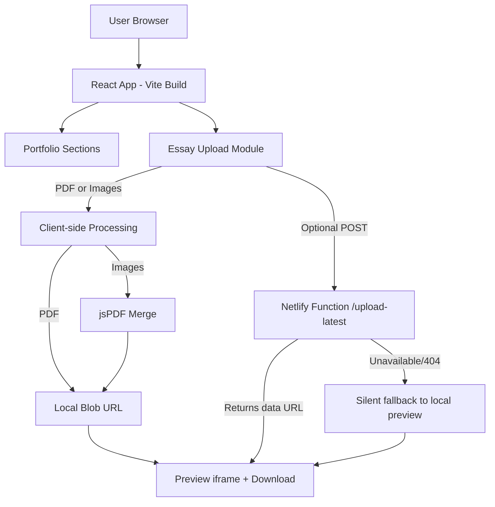

# E-Portfolio

A modern, animated personal portfolio built with React, TypeScript, and Vite.  
It showcases profile, skills, projects, achievements, contact form flow, and an academic handwritten essay submission section with live preview + download.

## Live Project

- **Production URL:** [https://https.xxxxx](https://https.xxxxx)

> Replace this with your final deployed URL when ready.

## Key Features

- Responsive one-page portfolio with smooth UI animations (`framer-motion`)
- Light/Dark theme toggle with local storage persistence
- Project cards with interactive modal details
- Contact form with validation and prefilled `mailto:` flow
- Handwritten Essay Submission:
  - Upload single PDF or multiple image pages
  - Auto-convert images to combined PDF (`jspdf`)
  - In-browser preview and download support
  - Default essay PDF (`/1.pdf`) shown on page load/reload
  - Optional Netlify Function upload (graceful fallback if endpoint unavailable)

## Tech Stack

- **Frontend:** React 19, TypeScript, Vite
- **Animation/UI:** Framer Motion, React Icons
- **PDF Processing:** jsPDF
- **Serverless:** Netlify Functions (`upload-latest`)
- **Tooling:** ESLint, TypeScript project references

## Project Structure

```text
E-portfolio/
├─ src/
│  ├─ App.tsx
│  └─ portfolio.css
├─ netlify/
│  └─ functions/
│     └─ upload-latest.js
├─ public/
│  ├─ 1.pdf
│  ├─ 1.png
│  └─ Resume.pdf
├─ package.json
└─ vite.config.ts
```

## Architecture Diagram (Mermaid)



## Handwritten Essay Workflow

1. Default file `/1.pdf` is loaded automatically on initial page load.
2. User uploads either:
   - one PDF, or
   - multiple image pages (`.jpg/.jpeg/.png`)
3. If images are uploaded, app generates a single multi-page PDF in browser.
4. Preview + download are immediately available from local blob/data URL.
5. App optionally tries Netlify upload endpoint:
   - on success: preview may use returned URL
   - on failure (e.g., 404): no blocking error shown; local preview/download continue

## Getting Started

### 1) Clone and install

```bash
git clone <your-repo-url>
cd E-portfolio
npm install
```

### 2) Run locally

```bash
npm run dev
```

Open the URL shown in terminal (usually `http://localhost:5173`).

### 3) Build for production

```bash
npm run build
```

### 4) Preview production build

```bash
npm run preview
```

## Netlify Functions

Current function:

- `/.netlify/functions/upload-latest` (POST)
  - Input JSON:
    - `file` (base64 string, required)
    - `contentType` (optional, defaults `application/pdf`)
    - `filename` (optional)
  - Returns:
    - `success`
    - `url` (inline data URL)
    - `filename`

Environment variable supported in frontend:

- `VITE_UPLOAD_LATEST_ENDPOINT` (optional override for upload endpoint)

## Scripts

- `npm run dev` - Start development server
- `npm run build` - Type-check and build production bundle
- `npm run preview` - Preview built app locally
- `npm run lint` - Run ESLint

## Deployment Notes

- Deploy to Netlify for serverless function support.
- Ensure static assets exist in `public/`:
  - `1.pdf` (default essay preview file)
  - `Resume.pdf`
  - `1.png` (profile image)
- If functions are unavailable, app still works with local essay preview/download.

## Future Improvements

- Persist latest uploaded essay in object storage (S3/R2) instead of data URL response
- Add CAPTCHA / spam protection for contact interactions
- Add tests for upload and preview flows (unit + integration)
- Add analytics and performance monitoring

## Author

**Aditya Kumar Bhardwaj**

- LinkedIn: [https://www.linkedin.com/in/aditya-bhardwaj-b89381297/](https://www.linkedin.com/in/aditya-bhardwaj-b89381297/)
- GitHub: [https://github.com/099Aditya](https://github.com/099Aditya)
